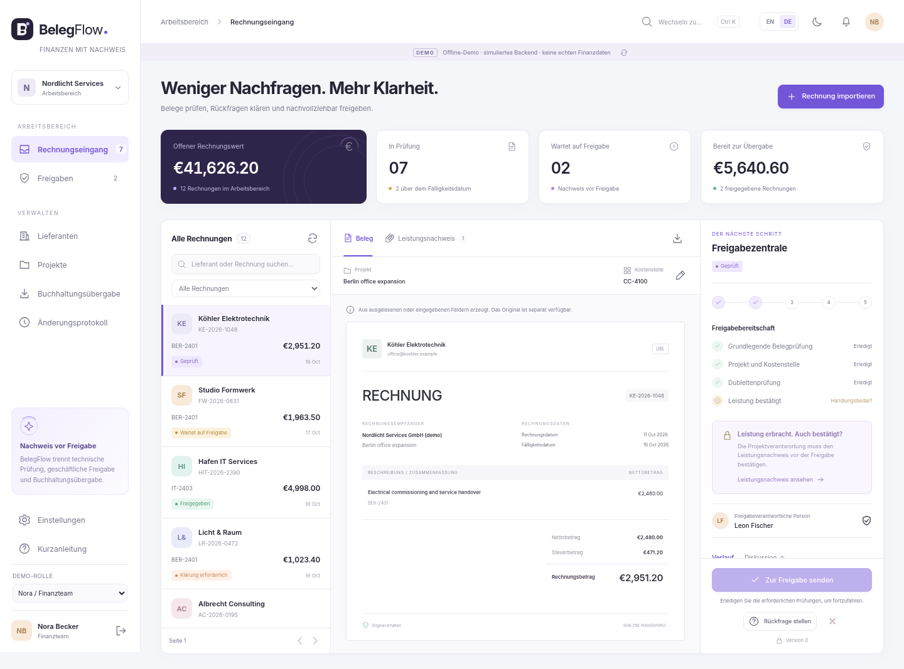

# BelegFlow
### Erst der Leistungsnachweis. Dann die Freigabe.

Zweisprachige Rechnungsprüfung mit Leistungsnachweisen für Dienstleistungsunternehmen mit mehreren Teams. Eigenstaendige Portfolio- und Pilotanwendung für Ahad Porkar.

[English](README.md) | [Benutzerhandbuch](docs/de/USER_GUIDE.md) | [Betrieb](docs/de/OPERATIONS.md) | [Entwicklung](docs/de/DEVELOPER_GUIDE.md) | [Testnachweise](docs/testing/VERIFICATION.md)



**Version 0.2.1 ist ein Entwicklungskandidat.** Der Multipart-Testcompiler-Fehler aus CI-Lauf 106020289651 ist im Quellcode korrigiert. Der bereitgestellte Lauf bestätigt 224 bestandene Frontend-Tests, Typprüfung und Produktions-Build (87,38 % Zeilen-Coverage). Lokal erneut ausgeführt: 306 Domänenfälle, 92 Client-Kerntests und 9 Berichtskontrollen. Der korrigierte Spring-/JDK-25-Build, sechs neue Multipart-Regressionen, PostgreSQL und echte Browser-Tests müssen noch ausgeführt werden. Siehe [Prüfbericht](docs/testing/VERIFICATION.md).

## Version 0.2.1: Tests und Dokumentation aller Module

[Modulvertraege](docs/de/MODULE_REFERENCE.md) | [Testbefehle](docs/de/TESTING.md) | [Fehler und Upgrade](docs/de/TROUBLESHOOTING.md) | [Testmatrix](docs/testing/TEST_MATRIX.md) | [Zweisprachiges HTML-Handbuch](docs/BelegFlow-Handbook.html)

Die Revision korrigiert den Jackson-Startfehler. Deklariert sind 306 Domänen-, 138 Server-Unit-/Konfigurations-, 47 PostgreSQL-, 92 Client-Core-, 132 React-Komponenten- und 14 echte E2E-Faelle. Lokal ausgefuehrt wurden 306 Domaenenfaelle, 92 Core-Faelle und 17 begrenzte Browser-Kompatibilitaetspruefungen. Die anderen Suites benoetigen den mitgelieferten Netzwerklauf; siehe Verifikationsbericht. Keine Datenbankmigration und kein Datenreset sind erforderlich.

```powershell
powershell -ExecutionPolicy Bypass -File .\scripts\verify-all.ps1
```

```bash
docker compose -f compose.quality.yml up --build --abort-on-container-exit --exit-code-from verifier
```

Der Teststack ist von Anwendungsdaten getrennt. Ergebnisse liegen in `quality-results/`. JaCoCo/V8 messen Coverage; die explizite Freigabepruefung erzwingt Grenzwerte. Uebersprungene Datenbanksuites können den Gesamtlauf nicht bestehen.

## Enthalten

Rechnungseingang in drei Bereichen, Originaldownload, begrenzte UBL-/CII-Extraktion, Basisprüfungen, manuelle PDF-Metadaten, Lieferanten, Projekte, Kostenstellen, Dublettenprüfung, Rückfragen, Leistungsabnahme, unabhängige Freigaben, zweite Freigabe ab einem konfigurierbaren Betrag, befristete Vertretung, interne Erinnerungen, Verlauf und Buchhaltungspaket mit Originalen und Hashwerten.

Englisch ist standardmaessig eingestellt. Deutsch, helle/dunkle Darstellung und mobile Ansichten sind vorhanden. Oberflaechensprache und Zahlenformat lassen sich getrennt einstellen.

## Start

Ohne Installation: `START-HERE.html` öffnen. Die Offline-Vorschau simuliert das Backend im Browser und verwendet eine klar gekennzeichnete aeltere Rendering-Laufzeit. Keine echten Kundendaten eingeben.

Für die echte Anwendung Docker mit Compose installieren und den Zugriff auf Paket- und Container-Registries erlauben:

```bash
sh scripts/start-demo.sh
```

Unter Windows:

```powershell
powershell -ExecutionPolicy Bypass -File .\scripts\start-demo.ps1
```

Nach erfolgreichem Build `http://localhost:8080` öffnen. Der Erststart laedt Abhängigkeiten. Fehler stehen in `docker compose logs app`; die Anwendung ersetzt einen fehlgeschlagenen Server nicht heimlich durch die Vorschau.

Finance: `finance@belegflow.demo`. Projektfreigabe: `leon@belegflow.demo`. Administration: `admin@belegflow.demo`. Weitere Konten: `mira@belegflow.demo`, `viewer@belegflow.demo`, `isolated@belegflow.demo`. Alle verwenden ausschliesslich in der lokalen Demo das Passwort `BelegFlow-Demo-2026!`.

## Vorführung

Die bereits geprüfte Rechnung `KE-2026-1048` öffnen. Finance darf sie ohne Leistungsabnahme noch nicht weiterleiten. Als Leon den Leistungsnachweis ansehen und akzeptieren. Als Finance die Freigabe anfordern. Als Leon unabhängig freigeben. Als Finance das Buchhaltungspaket erstellen und herunterladen.

Für die zweite Freigabe dient im echten Server `HIT-26041`; in der Offline-Vorschau ist es `KE-2026-1012`. Die Vorschau und der Server haben bewusst getrennte Beispieldaten.

## Technik und Tests

Java 25 LTS, Spring Boot 4.1.1, PostgreSQL 18.6, React 19.3.0, TypeScript 7.0.2, Vite 8.3.4, Node 24.22.0 LTS und Maven 3.10.0 sind konfiguriert. Der Clientkern ist strikt typisiert; die Ansichtskomponenten sind JSX. Ein eigener CSS-Entwurf ersetzt ein vorgefertigtes Admin-Template.

```bash
sh scripts/test-domain-offline.sh
cd frontend
npm install
npm run typecheck
npm test
npm run build
cd ..
./mvnw verify
```

Die echte PostgreSQL-Integration wird nur mit `BF_INTEGRATION=true` und einer separaten Testdatenbank ausgeführt. Die GitHub-Actions-Konfiguration führt diese Tests und Browserablaeufe gegen den echten Server aus. Der erste Netzwerk-Build muss `package-lock.json` erzeugen; diese Datei prüfen und vor einer Freigabe committen. Ein Lockfile wurde nicht erfunden.

## Grenzen

Kein DATEV-Liveanschluss, Mailboxabruf, E-Mail-Versand, OCR, KI, Zahlungsverkehr, Hauptbuch, Lohnabrechnung, Steuerberatung, Abonnementabrechnung, SSO/MFA oder frei zugaengliche Mandantenregistrierung. Erinnerungen erscheinen in der Anwendung. XML-Unterstuetzung bedeutet begrenzte Extraktion und Basisprüfung, nicht vollständige EN16931-/XRechnung-/ZUGFeRD-Konformitaet. PDF-Felder werden manuell eingegeben.

Keine GoBD-/DSGVO-Zertifizierung, qualifizierte elektronische Signatur oder rechtlich garantierte Archivierung wird behauptet. Sitzungen und lokale Benutzerkonten sowie PostgreSQL-`bytea` sind bewusste Umfangsentscheidungen. Mandantenfilter und zusammengesetzte Fremdschlüssel ersetzen keine Datenbank-RLS. Organisationsmitglieder sehen grundsätzlich die Rechnungen ihrer Organisation.

Die vorgeschlagene MIT-Lizenz erlaubt Dritten auch Weiterverwendung und Weiterverkauf. Diese Entscheidung vor der Veröffentlichung prüfen. Fremdkomponenten behalten ihre eigenen Lizenzen. Es sind keine proprietaeren GraphBPMS-Bestandteile oder echten Kundendaten enthalten.
