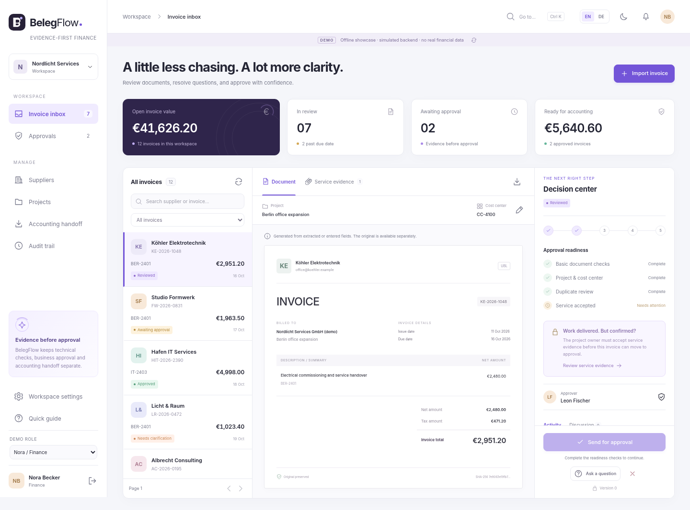

# BelegFlow
### Evidence before approval. Clarity before accounting.

A bilingual, evidence-first invoice-review application for multi-team service businesses. Built as an independent portfolio and pilot-product codebase for Ahad Porkar.

[Deutsch](README.de.md) | [User guide](docs/en/USER_GUIDE.md) | [Operations](docs/en/OPERATIONS.md) | [Architecture](docs/en/DEVELOPER_GUIDE.md) | [Verification](docs/testing/VERIFICATION.md)



**Release: 0.2.1 engineering candidate.** Repairs the multipart test-compiler error in uploaded CI run 106020289651. That run confirms 224 frontend tests, type checking and a production build passed (87.38% line coverage). Locally rerun for this patch: 306 domain checks, 92 client core cases and 9 report-gate checks. The corrected Spring/JDK 25 build, six new multipart regressions, PostgreSQL and production-browser suites still need execution. Read the [verification report](docs/testing/VERIFICATION.md) before making deployment claims.


## Version 0.2.1: compiler repair and full-module test package

[All module contracts](docs/en/MODULE_REFERENCE.md) | [Testing commands](docs/en/TESTING.md) | [Error diagnosis / upgrade](docs/en/TROUBLESHOOTING.md) | [Case matrix](docs/testing/TEST_MATRIX.md) | [Bilingual HTML handbook](docs/BelegFlow-Handbook.html)

The declared suites contain 306 domain, 138 server unit/configuration, 47 PostgreSQL integration, 92 frontend core, 132 React component and 14 real-application E2E cases. These are not all locally executed results; see the verification report. JaCoCo/V8 measure coverage and the explicit release mode enforces targets. A skipped integration suite cannot pass the full-stack gate.

```powershell
powershell -ExecutionPolicy Bypass -File .\scripts\verify-all.ps1
```

```bash
docker compose -f compose.quality.yml up --build --abort-on-container-exit --exit-code-from verifier
```

The test stack is separate from application data. Reports go to `quality-results/`. Strict coverage is opt-in during evidence collection and mandatory in the documented release checklist. The fix needs no database reset or migration change.

## What is implemented

A three-pane invoice inbox; original document downloads; bounded UBL/CII header extraction and basic checks; manual PDF metadata; supplier, project and cost-center records; duplicate review; clarification discussions; evidence acceptance; independent approvals; configurable high-value second approval; time-limited delegation; in-app reminders; audit history; and a durable accounting ZIP with originals and hashes.

English is the initial language. German translations, locale-aware number/date formatting, light/dark themes and responsive mobile panes are included. Interface language and business number formatting are separate preferences.

The central distinction is **technical checks != business approval != accounting handoff**. A document can pass basic validation and still be blocked because the responsible project owner has not accepted the service evidence.

## Start here

**Inspect without installation:** open `START-HERE.html`, then the offline showcase. It has a simulated browser-local backend and a clearly labelled legacy rendering runtime. It is not the real server and must never contain customer data.

**Run the actual application:** install Docker Desktop/Engine with Compose and allow access to npm, Maven and the container registries. From the extracted repository:

```bash
# Linux / macOS / WSL
sh scripts/start-demo.sh
```

```powershell
# Windows PowerShell, from the project directory
powershell -ExecutionPolicy Bypass -File .\scripts\start-demo.ps1
```

Open `http://localhost:8080` after the build and health checks finish. The first build downloads dependencies and is not instantaneous. A failure is not silently replaced by demo HTML; inspect `docker compose logs app`.

| Demo role | Email | Password |
|---|---|---|
| Finance / Nora | finance@belegflow.demo | BelegFlow-Demo-2026! |
| Project approver / Leon | leon@belegflow.demo | BelegFlow-Demo-2026! |
| Administrator / Alex | admin@belegflow.demo | BelegFlow-Demo-2026! |
| Project approver / Mira | mira@belegflow.demo | BelegFlow-Demo-2026! |
| Read-only / Jan | viewer@belegflow.demo | BelegFlow-Demo-2026! |
| Separate organization | isolated@belegflow.demo | BelegFlow-Demo-2026! |

These accounts are deliberately public synthetic fixtures. Demo Compose binds the HTTP port to loopback. Never expose this installation publicly or change it into a production installation by merely toggling a flag.

## A three-minute business demonstration

Open `KE-2026-1048` in its **Reviewed** state. Finance cannot submit it because service acceptance is missing. Switch to Leon, open **Service evidence**, inspect the attachment and accept the service. Return to Finance and submit. Leon approves independently. Finance creates and downloads the accounting package. Show the original XML, manifest and timeline, not just a final green status.

For the high-value scenario, the real server fixture `HIT-26041` already has its first approval and needs an independent administrator. The offline showcase uses `KE-2026-1012` for the equivalent scenario; its fixtures intentionally differ from the database fixtures.

## Technology

| Layer | Configured baseline |
|---|---|
| Backend | Java 25 LTS; Spring Boot 4.1.1; Spring Security; Spring JDBC; Flyway |
| Database | PostgreSQL 18.6; explicit SQL and tenant-scoped foreign keys |
| Frontend | React 19.3.0; TypeScript 7.0.2; Vite 8.3.4; custom CSS design system |
| Build | Node 24.22.0 LTS; project-owned Maven 3.10.0 bootstrap launcher |
| Tests | JUnit; Mockito; actual PostgreSQL integration specifications; Node test runner; Playwright 1.64.1 |
| Deployment | Multi-stage Dockerfile, local and pilot-production Compose examples, GitHub Actions |

Typed models, API client and application store are strict TypeScript. View components are JSX; this is not a claim that every component is statically typed. Spring-managed dependency versions are inherited rather than individually overridden. See [version sources](docs/VERSIONS.md).

## Verify

```bash
# Dependency-free core checks, JDK 21 or newer
sh scripts/test-domain-offline.sh

# Modern toolchain / registry access required
cd frontend
npm install                 # first resolution; review and commit package-lock.json
npm run typecheck
npm test
npm run build
cd ..
./mvnw verify               # database integration tests skip unless explicitly enabled

# Real PostgreSQL integration tests (dedicated disposable test database!)
BF_INTEGRATION=true BF_DATABASE_URL=jdbc:postgresql://localhost:5432/belegflow_test \
BF_DATABASE_USER=belegflow BF_DATABASE_PASSWORD=your-test-secret ./mvnw verify
```

The frontend lockfile is intentionally not fabricated. The first networked build resolves it; review and commit it before releasing. GitHub Actions runs the actual Spring/PostgreSQL tests, starts the built application and exercises real-browser journeys. Do not add a passing badge until that workflow actually passes.

## Boundaries

No live DATEV connector, mailbox polling, outgoing email, OCR, AI, bank payments, ledger, payroll, tax advice, subscription billing, SSO/MFA or self-service multi-organization signup is provided. Reminders are in-app. Invoice XML support is bounded extraction/basic validation, **not complete EN16931, XRechnung or ZUGFeRD conformance validation**. PDF files are not OCR-processed; their fields are entered manually. No GoBD/GDPR certification, qualified electronic signature or legal archive guarantee is claimed.

Production uses authenticated sessions and PostgreSQL `bytea` storage, not an external identity provider or object store. Those are deliberate, documented scope choices. Tenant isolation is enforced in application queries and composite references, not database row-level security. All active members can read their organization's invoices; this is not per-project read authorization.

## Repository

`domain/`: framework-free policy and parsers. `server/`: HTTP, security, SQL, services and migrations. `frontend/`: production client and tests. `samples/`: non-conformant extraction fixtures. `preview/`: separately labelled offline compatibility interface. `docs/`: English/German handbooks, API reference, code map and evidence. `deploy/`, `scripts/`, `.github/`: build and operational material.

## License and public portfolio

The proposed repository license is MIT. This permits reuse and resale by others; review that choice before publishing a commercial repository. Third-party dependencies keep their own licenses. No proprietary GraphBPMS code, real invoice or customer identity is included. Generated code and all commercial/security claims should be reviewed by the repository owner before publication.
