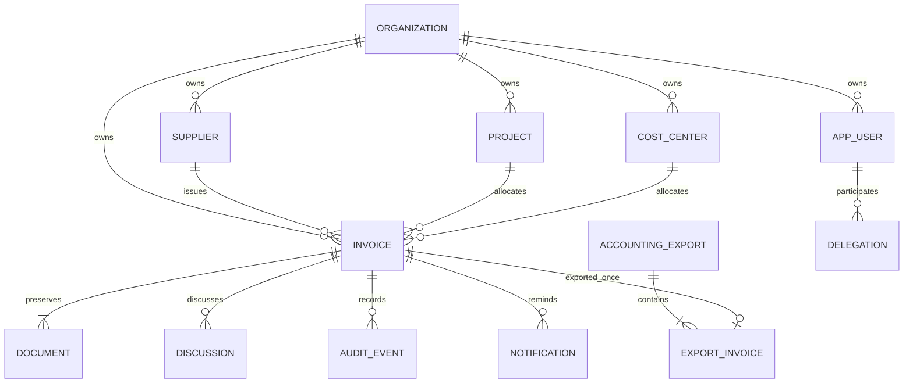

# Data model

Source of truth: `server/src/main/resources/db/migration/V1__initial_schema.sql`.

All business references use an organization boundary. The schema includes original-hash uniqueness per tenant, one original per invoice, organization-specific catalog keys, unique daily reminder identity and unique export idempotency keys. Email uniqueness is global. This release has no separate general-ledger, bank transaction, tax-account or subscription table.

Document bytes and ZIPs are stored in the database, not filesystem paths. Amounts use numeric precision and scale, not float. Row versions belong to invoice mutations. Date-only fields remain SQL dates; events are timezone-aware timestamps. Original/document/audit/export update/delete triggers are ordinary database safeguards, not DBA-proof immutability.

Deutsch: Das Schema ist mandantenbezogen; zusammengesetzte Verweise verhindern organisationsfremde Beziehungen. Hash-, Reminder- und Idempotenz-Eindeutigkeit dienen konkreten Rennen/Dubletten, nicht einer allgemeinen Buchhaltungszertifizierung. Rechnungsdaten, Dokumentbytes, Diskussion, Audit und Uebergabepakete liegen getrennt vor. Ein Hauptbuch und Abonnementabrechnung existieren nicht.
