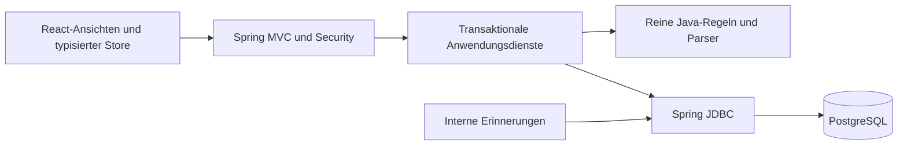

# Architektur und Entwicklung

[English](../en/DEVELOPER_GUIDE.md) | [API](../api/API.de.md) | [Codeverzeichnis](../code/CODE_MAP.md)

## Aufbau

Zwei Maven-Artefakte bilden einen modularen Monolithen. `domain` hat keine Spring-Abhängigkeit; `server` übernimmt HTTP, Sitzungen, SQL und Zeitsteuerung. Kernregeln erhalten Fakten statt Datenbankobjekte. Logische Pakete decken Rechnungen, Identitaet, Stammdaten, Dokumente, Audit, Export und Erinnerungen ab. Spring Modulith, Camunda, Kafka, Redis, externer Objektspeicher und Kubernetes sind nicht eingebaut.

## Anfrage und Transaktion

Security authentifiziert die Sitzung. `IdentityService` liest den aktiven Benutzer und seine Authentifizierungsversion erneut. Vom Client übertragene Mandanten- oder Rollenwerte gelten nicht als Berechtigungsnachweis. Dienste ermitteln die Organisation, prüfen die Aktion, sperren den Rechnungsdatensatz, vergleichen `version`, rufen die Kernregel auf und schreiben Zustandswechsel und Audit in derselben Transaktion.

Listen und Detailabfragen filtern nach Organisation. Zusammengesetzte Fremdschlüssel verhindern Verweise auf fremde Lieferanten, Projekte, Benutzer und Rechnungen. Das ist keine Datenbank-RLS. Eine bekannte UUID ist keine Zugriffsberechtigung. Schreibzugriffe verwenden ebenfalls serverseitig bestimmte Mandantenkriterien.

Zeilensperren plus optimistische Version erzeugen bei veralteten Änderungen HTTP 409. Import und Export sperren zusätzlich die Organisation; Exporte sortieren Rechnungen vor dem Sperren. Das verhindert Rennen bei kleinen Stapeln, begrenzt aber die Parallelitaet. Vor größtem Volumen messen statt Durchsatz zu behaupten.

Der Server liefert stabile Fehlercodes. Der Client übersetzt diese nach EN/DE. Unerwartete Fehler enthalten eine Referenz, keine SQL-Fehlermeldung. Void-Endpunkte liefern HTTP 200 ohne Body; der Client kann damit umgehen.

## Geld, Dokumente und XML

Java verwendet `BigDecimal`, die API Dezimalzeichenfolgen und der Client `BigInt`-Centwerte. `MoneyRules` begrenzt Stellenzahl und Nachkommastellen und prüft Summen exakt. Keine binaeren Gleitkommazahlen für finanzielle Entscheidungen einsetzen. Rechnungsdaten sind Kalendertage; Ereignisse sind Zeitpunkte mit Darstellung für Europe/Berlin.

Der JDK-DOM-Parser deaktiviert DTD, externe Entitaeten, externe Schemas und XInclude. Namespaces und Pfade sind explizit; Dateigrößen sind begrenzt. Trotzdem ist das nur ein Extraktions-/Basisprüfungsumfang, kein rechtlicher Konformitaetsvalidator. Eine Erweiterung braucht gepflegte Schema-/Schematron-Artefakte, Versionen, Lizenzen und passende gültige/ungültige Referenzdateien. Gleiche lokale XML-Tagnamen allein reichen nicht zur sicheren Formaterkennung.

Originalbytes bleiben unverändert. PDFs verwenden manuelle Metadaten ohne OCR. Dateisignaturen ersetzen keinen Malware-Scanner. Finanzielle Korrekturen über korrigierte Originale und einen nachvollziehbaren Prozess behandeln. Das erzeugte Rechnungsblatt ist deshalb ausdrücklich als strukturierte Darstellung gekennzeichnet.

## Leistungsabnahme und Status

`WorkflowPolicy` prüft `WorkflowFacts`, Akteur, Vertretung und gewuenschte Aktion. Die Abnahme prüft Projektverantwortung, gültige Vertretung, Erstellerverbot, bearbeitbaren Zustand und vorhandene Nachweise. Neue Nachweise oder ein Projektwechsel setzen die Abnahme zurück. Die Weiterleitung speichert die Anforderung einer zweiten Freigabe. Klaerung/Wiedereröffnung setzen fruehere Unterschriften zurück. Export verlangt die gespeicherten Freigabefakten.

Keine freie Statusauswahl einführen. Neue fachliche Aktionen brauchen Invarianten, Audit-Ereignis, Unit-Tests, API und übersetzte UI gemeinsam. Synthetische Startdaten duerfen Testzustaende direkt aufbauen; Produktionsendpunkte duerfen diesen Weg nicht wiederverwenden.

## Speicherung und Export

Die erste Migration speichert Dateien und ZIPs als `bytea` samt Hash und Metadaten. Trigger verhindern normale Änderungen/Löschungen, nicht jeden privilegierten Datenbankadministrator. Ein Dump kann den Bestand konsistent sichern. Für sehr grosse Archive braucht es eine geplante Objektspeichermigration mit Integritaets-, Quarantaene- und Aufbewahrungskonzept.

Export erzeugt Originale/Nachweise, generische CSVs, Hinweise und Manifest. SHA-256 belegt Bytegleichheit, nicht Lieferantenauthentizitaet. Ein gespeicherter Request-Fingerprint bindet den Idempotenzschlüssel an Rechnungen und Versionen. Derselbe Schlüssel mit anderem Inhalt wird abgewiesen. Es gibt keine entfernte Buchhaltungs-API und keine Behauptung externer Zustellung; deshalb ist hier auch keine Outbox implementiert.

## Client

`models.ts` definiert API-Daten, `api.ts` Requests/CSRF/Downloads und `store.ts` Zustandswechsel und Formularkontext. Request-Tickets verhindern, dass alte Antworten neue Auswahlen überschreiben. Dialoge merken Rechnungs-ID und Version, damit ein Auswahlwechsel eine Aktion nicht unbemerkt auf eine andere Rechnung richtet. Ein HTTP-Fehler aktiviert niemals synthetische Daten als Fallback.

`App.jsx` kombiniert die Fachseiten aus `features/`; gemeinsame Elemente und native Dialoge liegen in `components/`. `main.jsx` verwendet React 19 mit `createRoot` und `useSyncExternalStore`. Der Store-/API-/Modellkern ist strikt TypeScript, die JSX-Ansichten werden nicht von `tsc` typgeprüft. Diese Grenze offen benennen.

`i18n.ts` enthält EN/DE-Schlüssel; Tests vergleichen Schlüssel und Platzhalter. Benutzernamen, Lieferanten und Kommentare werden nicht automatisch übersetzt. Zahlenformat und Sprache trennen. CSS stellt Dichte, Fokus, mobile Bereiche, Themes und reduzierte Bewegung bereit. Externe Fontdateien, Icon-Dienste oder Tracking sind nicht erforderlich.

Die getrennte Vorschau verwendet dieselben Ansichten und denselben Store mit `DemoApi`. Ihre eingebundene React-16-Laufzeit war die lokal verfügbare Renderingdatei. Sie ist weder ein Authentifizierungssystem noch eine Produktiv-Fallbackfunktion. Der normale Einstiegspunkt importiert sie nicht.

## Tests und Erweiterungen

Die reinen Kernregeln laufen ohne Downloads mit Java-21-Bytecodekompatibilitaet; Maven führt dieselben Faelle unter JUnit mit der konfigurierten Java-25-Umgebung aus. Adaptertests prüfen Identitaet, Stammdaten, Dokumentzugriff, Exportberechtigung, Erinnerungen und SQL-Werte. Echte SQL-Ausführung bleibt eine eigene Integration.

`IntegrationTest` benoetigt `BF_INTEGRATION=true` und eine wegwerfbare PostgreSQL-Datenbank. Geprüft werden Filter, Mandantentrennung, Versionen, bytegleicher Export und Idempotenz. Node-Tests prüfen Formatierung, Übersetzungen, Store-Rennen und HTTP-Client. Playwright-Spezifikationen richten sich an die echte laufende Anwendung. Lokal ausgeführte und noch nicht ausgeführte Faelle stehen getrennt im Testbericht.

Jede Änderung zuerst durch einen fehlschlagenden Regressionstest beschreiben. Serveraktionen und Clientzustaende gemeinsam erweitern. Neue Flyway-Version anfuegen statt eingesetzte Migration umzuschreiben. Lockfile, Lizenzen und CI vor Freigabe prüfen. `mvnw` ist ein kleines projekteigenes, checksum-geprüftes Startskript und nicht die offizielle Wrapper-Binaerdatei.

Domain-Javadoc kann mit `javadoc -d .build/javadoc $(find domain/src/main/java -name '*.java')` erzeugt werden. Das Codeverzeichnis führt Quelloberflaechen und Request-Records auf. Inline-Kommentare erklaeren Sicherheits- und Transaktionsentscheidungen; API-Beispiele dokumentieren Aufrufe.

## Bewusste Architekturentscheidungen

Modularer Monolith: eine nachvollziehbare Installation statt verteiltem Aufwand. JDBC: explizite Mandantenkriterien und Sperren, dafür manuelles Mapping. Lokale Sitzungen: ohne externe Konten reproduzierbar, aber SSO/MFA bleibt Erweiterung. Datenbankdateien: konsistente Sicherung, aber Speicherwachstum messen. Kein generischer BPM-Motor: konkrete Regeln sind testbar, freies BPMN-Modellieren fehlt. Eigene React-Oberflaeche: klare Produktidentitaet, eigener Pflegeaufwand. Keine Pflicht-KI: fachliche Regeln bleiben deterministisch. Manuelles Buchhaltungspaket: ehrliche Schnittstellengrenze statt vorgetaeuschtem DATEV-Anschluss.

## Echter Konnektor als eigene Erweiterung

Externe Zustellung von Freigabe und Exportstatus trennen. Remote-IDs, Idempotenz, Wiederholungen und Tokenwechsel speichern. Bei zuverlaessiger externer Zustellung eine Outbox entwickeln. Doppelte Schreibvorgaenge verhindern und widerrufene Berechtigungen behandeln. Erst mit echtem Provider-Sandboxzugriff testen und danach die Integration bewerben. CSV-Namen oder Mockantworten beweisen keinen DATEV-Liveanschluss.
