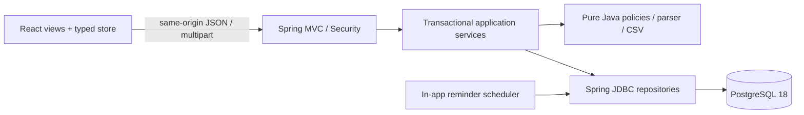

# Architecture and developer guide

[Deutsch](../de/DEVELOPER_GUIDE.md) | [API](../api/API.md) | [Code map](../code/CODE_MAP.md)

## Architecture

This is a two-artifact modular monolith, not microservices. The `domain` module has no Spring dependency. The `server` module owns HTTP, sessions, persistence and scheduling. Domain business functions are deterministic where possible and accept facts rather than database objects. Logical server packages are invoice workflow, identity, catalog, documents, audit, exports and notifications. Spring Modulith, Camunda, Kafka, Redis, object storage and Kubernetes are not installed components.

## Request, transaction and concurrency

Security authenticates a session. `IdentityService` re-reads the active user and authentication version; client-supplied tenant/role values are never authorization evidence. Services obtain tenant identity, check role/action requirements, read the invoice under a row lock, compare its expected version, invoke the pure policy, persist the change and append audit in the same transaction.

Normal list/detail queries always include tenant filters. Composite foreign keys prevent references to a different organization's suppliers, projects, users and invoices. This is defense in depth, not SQL row-level security. An internal UUID is not proof of permission. Update APIs use server-derived tenant criteria even when a foreign UUID is guessed.

Invoice commands use row locks plus optimistic `version`; concurrent stale mutations return 409. Import and export also lock the organization row, deliberately serializing small-volume jobs to avoid duplicate races. Export invoices are sorted before locking. The price is lower concurrency for large bulk workloads; benchmark before expanding the current 200-2,000/month pilot hypothesis. No throughput claim is made.

The server returns domain codes, not localized server prose. The client translates errors into EN/DE. Unexpected failures return a reference; database exception messages are not exposed. HTTP success for void controller methods is 200 with an empty body; the client deliberately handles empty responses.

## Financial data and validation

Use `BigDecimal` for Java amounts and decimal strings over the API. `MoneyRules` requires bounded precision and two decimals and tests exact totals. The browser uses `BigInt` cents for client checks and Intl for presentation. Do not replace either with binary float arithmetic. Invoice-date fields are dates, not midnight UTC timestamps. Events are instants displayed in Europe/Berlin.

`InvoiceXmlParser` uses secure JDK DOM configuration: no DTDs, external entities, external schemas or XInclude. Supported namespaces and paths are explicit. Uploaded input is bounded by byte size. This parser extracts a supported subset; passing it is not a legal invoice conformance statement. Extend via a separate validator interface only after selecting maintained schema/Schematron artifacts, documenting versions/licenses and adding official valid/invalid test corpora. Do not silently accept a different XML dialect based only on a matching local tag name.

Original documents remain byte-identical. PDF has manual metadata, no OCR. Signature checks are not malware scanning. Financial corrections should be represented by a corrected original/business process, not silent edits to a historical source. The generated invoice sheet is explicitly labelled as structured data.

## Evidence and state machine

`WorkflowPolicy` receives `WorkflowFacts` and an actor. It controls transitions and separation of duties. Evidence acceptance itself is a service operation checking project responsibility, active delegation, creator restriction, editable state and attachment existence. Uploading new evidence or changing project invalidates acceptance. Submission stores the second-approval requirement. Clarification/reopening reset earlier signatures. Export requires valid stored approval facts.

Do not add a status dropdown that writes arbitrary enum values. Add an explicit command, invariants, audit event, unit tests, API operation and localized UI state together. Seed data may directly construct synthetic states; production APIs may not reuse that shortcut.

## Storage and handoff

The initial migration stores documents and generated ZIPs as `bytea`, with checksum and content metadata. Immutable-row triggers make ordinary update/delete attempts fail. They do not defeat privileged administrators. This bounded design makes a consistent backup straightforward; very large archives need a deliberate object-store migration, integrity checks, quarantine and deletion/retention design.

Export creates original/evidence entries, generic invoice/audit CSVs, notices and a manifest. SHA-256 verifies bytes, not supplier authenticity. The persisted request fingerprint ties an idempotency key to invoice IDs and versions. A changed payload with a reused key fails instead of returning an unrelated package. There is no remote accounting API, transactional outbox or external-delivery claim because the handoff is a local stored artifact.

## Frontend architecture

`models.ts` describes API data. `api.ts` owns fetch, session credentials, CSRF, error handling and downloads. `store.ts` owns application state, requests, dialog context and mutations. Race tickets invalidate stale list/detail/auth responses. Captured invoice ID/version in dialogs prevents a subsequent selection from silently retargeting the action. The store never switches to synthetic data after an HTTP error.

`App.jsx` composes feature pages. `features/` contains invoice, catalog, accounting, audit, identity and settings views; `components/` contains shared primitives, the shell and native dialogs. `main.jsx` uses React 19 `createRoot` and `useSyncExternalStore`; views subscribe to the typed external store. Forms deliberately use native browser validation and simple field names. The API/model/store layer is strict TypeScript; the JSX view layer is not included in `tsc` and should not be described as fully typed.

`i18n.ts` is an EN/DE dictionary with automated key/placeholder parity checks. User-entered supplier names, comments and invoice descriptions are not machine-translated. Separate number locale from interface locale. CSS supplies density, focus styling, responsive panes, theme variables and reduced-motion behavior. No external font files, icon service, tracking script or remote illustration is needed.

The compatibility showcase imports the same views/store but replaces the API with `DemoApi`. Its bundled React 16 runtime was the only local rendering binary available. It is not an authentication implementation or a fallback product mode. The production entrypoint never imports it. Source is included for inspection; the generated preview remains clearly labelled.

## Tests and extension discipline

Pure-core checks run without dependency downloads using Java 21 bytecode compatibility. Maven reruns the same cases under JUnit on the configured Java 25 build. Adapter unit tests cover identity, catalog, storage scoping, export authorization, reminders and SQL conversion; they are not substitutes for SQL execution. `IntegrationTest` requires `BF_INTEGRATION=true` and a real disposable PostgreSQL database. It verifies Spring filters, tenant isolation, version conflicts, byte-preserving export and idempotency. Node tests cover formatting, translation parity, store races and the HTTP client. Playwright specifications target the real running application.

Use a branch and a failing regression test for every business change. Update server capabilities and client states together. Add a new Flyway file, never alter a deployed migration. Keep test credentials synthetic. Generate/review the dependency lock, audit licenses and run CI before release. `mvnw` is a small project-owned Maven downloader with checksum verification, not the official wrapper binary.

Generate domain Javadoc with `javadoc -d .build/javadoc $(find domain/src/main/java -name '*.java')` using a compatible JDK. `docs/code/CODE_MAP.md` lists the source surfaces and request records; inline comments explain non-obvious security/transaction decisions. The API reference includes examples and mutation requirements.

## Deliberate decisions

| Decision | Reason / cost |
|---|---|
| Modular monolith | One understandable deployment; package discipline must be reviewed as it grows. |
| Explicit JDBC | Tenant criteria, lock order and SQL are visible; mapping is manual rather than generated. |
| Local session identity | Reproducible without external accounts; enterprise MFA/SSO is an explicit release extension. |
| PostgreSQL document bytes | Consistent transactional backup; storage growth/large downloads need measurement. |
| No generic BPM engine | Application-specific gates are easy to test; arbitrary BPMN editing is not a feature. |
| Custom React UI | Distinctive workflow-oriented design; more ownership than a component-template skin. |
| No mandatory AI | Core decisions remain deterministic and usable without paid external credentials. |
| Manual accounting handoff | Truthful integration boundary; live DATEV requires separate vendor access and tests. |

## Adding a live connector safely

Define an adapter boundary and delivery state separate from invoice approval/export. Store remote operation IDs and retry/idempotency state. Design an outbox if reliable external delivery is required. Keep original payload hashes, prevent duplicate remote writes, handle token renewal and revoked authorization, and test against the actual provider sandbox before advertising a live integration. A CSV filename or a mocked response is not proof of a DATEV connector.
